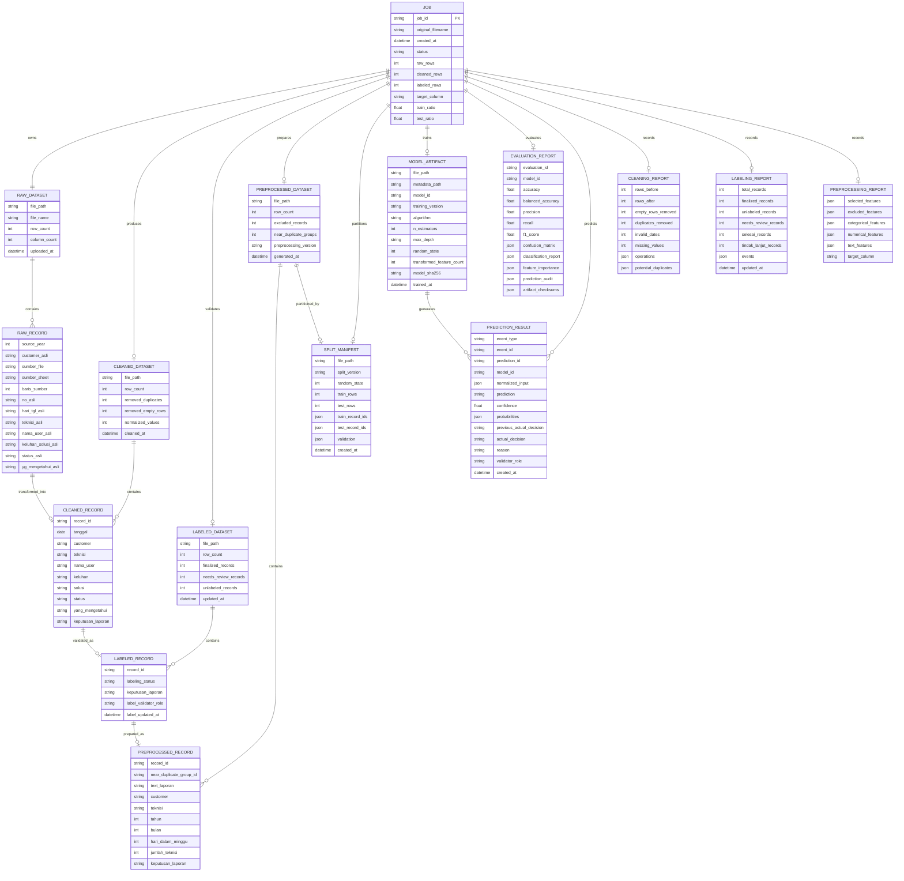

# ERD / Logical Data Model
## Sistem Data Mining Random Forest PT Maxkomp

> **Catatan penting**
>
> Project ini **tidak menggunakan database relasional**.
> Dokumen ini memakai istilah **ERD** sebagai rancangan **logical entity relationship** agar hubungan data, file, proses, dan output sistem tetap jelas.
>
> Persistensi utama menggunakan:
>
> - Excel (`.xlsx`)
> - JSON (`.json`)
> - JSON Lines (`.jsonl`)
> - Joblib (`.joblib`)
> - Filesystem per `job_id`

---

## 1. Tujuan Sistem

Sistem digunakan untuk mengelola proses data mining laporan teknisi dan administrasi PT Maxkomp melalui aplikasi berbasis web dengan alur:

```text
Upload Data Mentah
        ↓
Data Understanding
        ↓
Data Cleaning
        ↓
Dataset Bersih
        ↓
Preprocessing
        ↓
Feature Selection / Feature Engineering
        ↓
Train-Test Split
        ↓
Random Forest
        ↓
Evaluation
        ↓
Prediction
```

---

## 2. Konsep Penyimpanan

Setiap proses dataset mempunyai satu `job_id`.

Struktur penyimpanan per job:

```text
storage/
└── jobs/
    └── <job_id>/
        ├── raw/
        │   └── dataset.xlsx
        ├── cleaned/
        │   └── dataset_cleaned.xlsx
        ├── labeled/
        │   └── dataset_labeled.xlsx
        ├── preprocessed/
        │   └── dataset_preprocessed.xlsx
        ├── model/
        │   ├── model_pipeline.joblib
        │   └── model_metadata.json
        ├── reports/
        │   ├── data_understanding.json
        │   ├── cleaning_report.json
        │   ├── labeling_report.json
        │   ├── input_labels.json
        │   ├── preprocessing_report.json
        │   ├── split_manifest.json
        │   ├── evaluation.json
        │   └── feature_importance.json
        ├── predictions/
        │   └── predictions.jsonl
        └── config/
            └── job.json
```

---

# 3. Logical ERD



---

# 4. Entity Utama

## 4.1 `JOB`

`JOB` adalah entity pusat.

Setiap upload dataset menghasilkan satu `job_id`.

Contoh metadata job:

```json
{
  "job_id": "01JQ7M4QABWZ8F6H",
  "original_filename": "Data_Mentah_Gabungan_PT_MAXKOMP.xlsx",
  "status": "CLEANED",
  "created_at": "2026-09-15T20:00:00+07:00"
}
```

Status yang diperbolehkan:

```text
UPLOADED
ANALYZED
CLEANED
LABELING
LABELED
PREPROCESSED
TRAINED
EVALUATED
```

Prediction tidak harus mengubah status job.

---

# 5. Struktur Data Mentah

File input utama:

```text
Data_Mentah_Gabungan_PT_MAXKOMP.xlsx
```

Sheet:

```text
DATA_MENTAH
```

Kolom dasar:

| Kolom | Tipe Awal | Fungsi |
|---|---|---|
| `Tahun_Sumber` | integer | Tahun folder/file sumber |
| `Customer_Asli` | string | Nama customer sebelum standardisasi |
| `Sumber_File` | string | Nama file sumber |
| `Sumber_Sheet` | string | Nama sheet sumber |
| `Baris_Sumber` | integer | Posisi baris asli |
| `No_Asli` | mixed | Nomor laporan asli |
| `Hari_Tgl_Asli` | mixed | Tanggal asli |
| `Teknisi_Asli` | string | Nama teknisi asli |
| `Nama_User_Asli` | string | Nama user asli |
| `Keluhan_Solusi_Asli` | text | Isi laporan asli |
| `Status_Asli` | string | Status asli |
| `Yg_Mengetahui_Asli` | string | Pihak yang mengetahui |

### Aturan

Data pada tahap ini **tidak boleh dianggap bersih**.

Data mentah boleh mengandung:

- duplikasi,
- baris kosong,
- placeholder,
- tanggal salah,
- format berbeda,
- nama teknisi tidak konsisten,
- nama customer tidak konsisten,
- nilai kosong,
- karakter newline,
- teks keluhan dan solusi tercampur.

---

# 6. Data Bersih

Dataset bersih hanya boleh dihasilkan oleh proses cleaning aplikasi.

Rekomendasi struktur minimal:

| Kolom | Keterangan |
|---|---|
| `record_id` | ID internal hasil cleaning |
| `tanggal` | Tanggal valid |
| `customer` | Customer terstandardisasi |
| `teknisi` | Teknisi terstandardisasi |
| `nama_user` | Nama user hasil normalisasi |
| `keluhan` | Keluhan apabila dapat dipisahkan |
| `solusi` | Solusi apabila dapat dipisahkan |
| `status` | Status hasil normalisasi |
| `yang_mengetahui` | Pihak yang mengetahui |
| `keputusan_laporan` | Target klasifikasi jika sudah tersedia |

> `keputusan_laporan` **tidak boleh dibuat otomatis tanpa aturan bisnis atau label ground-truth yang sah**.

Kelas final:

```text
SELESAI
TINDAK_LANJUT
```

`SELESAI` berarti laporan dapat ditutup karena tidak ada tindakan teknis atau administratif lanjutan. `TINDAK_LANJUT` berarti laporan belum dapat ditutup karena masih ada tindakan yang harus diselesaikan. Nilai per record berasal dari keputusan admin historis atau historical labeling yang tervalidasi.

Revisi workflow final: dataset berlabel disediakan di folder `dataset/` sebagai workbook
19 kolom (12 sumber utuh + 7 target/audit). Upload mengimpor label; workbook mentah 12 kolom
diidentifikasi otomatis dengan `ai-assisted-id-v1`. Snapshot `input_labels.json` menyimpan
label source-row/job-specific record ID dan checksum raw. Cleaning mentransfer keputusan ke
artifact cleaned/labeled; tidak ada tahap atau UI labeling manual. Needs Review memiliki
target null dan dikecualikan dari training. Mutasi API labeling dihapus, GET audit tetap
read-only. Kelanjutan job lama hanya melengkapi UNLABELED; artifact/model yang sudah diproses
tidak diubah. Sumber label tetap weak supervision dan provenance tidak disamarkan.

---

# 7. Data Preprocessing

Tahap preprocessing menghasilkan representasi fitur di dalam Scikit-learn Pipeline. Matrix hasil OneHot/TF-IDF tidak wajib disimpan sebagai Excel.

Mapping canonical berasal dari `backend/config/customer_mapping.json` dan `backend/config/technician_mapping.json`. Mapping tidak boleh dibuat tersebar atau diinferensikan tanpa persetujuan.

Contoh fitur kandidat:

```text
customer
teknisi
jumlah_teknisi
kategori_pekerjaan
jumlah_item_pekerjaan
bulan
hari
fitur_teks_keluhan_solusi
```

Kolom berikut tidak boleh digunakan sebagai fitur prediktif:

```text
record_id
No_Asli
Sumber_File
Sumber_Sheet
Baris_Sumber
job_id
```

Alasannya: metadata tersebut tidak merepresentasikan karakteristik pekerjaan dan berpotensi menyebabkan model mempelajari sumber data, bukan pola bisnis.

---

# 8. Target Random Forest

Target harus ditentukan secara eksplisit.

Kelas final:

```text
SELESAI
TINDAK_LANJUT
```

Prediksi dilakukan setelah teknisi mengisi keluhan dan solusi/tindakan, tetapi sebelum admin menetapkan keputusan akhir. Karena itu `Keluhan_Solusi_Asli` boleh digunakan sebagai fitur, sedangkan keputusan akhir admin tidak boleh masuk ke fitur.

## Larangan

Jangan membuat target berdasarkan dugaan.

Jangan menganggap:

```text
Status kosong = Tidak OK
```

tanpa bukti atau aturan bisnis.

Jangan menggunakan field yang secara langsung maupun tidak langsung memuat keputusan akhir admin sebagai fitur.

---

# 9. Cleaning Report

Setiap proses cleaning wajib menghasilkan laporan.

Snapshot hasil verifikasi dataset saat ini (16 September 2026; hitung ulang jika
dataset atau aturan cleaning berubah):

```json
{
  "rows_before": 1541,
  "rows_after": 1028,
  "removed": {
    "empty_rows": 77,
    "duplicates": 436
  },
  "normalization": {
    "customer": 14,
    "technician": 18
  },
  "missing_values": {
    "Nama_User": 23,
    "Status": 7
  }
}
```

Angka di atas hanya contoh struktur.
Nilai aktual harus dihitung aplikasi dari dataset yang sedang diproses.

---

# 10. Model Artifact

Pipeline model dan preprocessing disimpan sebagai satu artifact:

```text
model/model_pipeline.joblib
```

Metadata disimpan sebagai:

```text
model/model_metadata.json
```

Pipeline mencakup `ColumnTransformer`, transformasi fitur, dan `RandomForestClassifier` agar preprocessing dan model selalu kompatibel.

Metadata juga menyimpan checksum model, dataset preprocessing dan split manifest; distribusi kelas train; hash daftar train/test ID; versi dependency; serta bukti bahwa model berhasil di-load ulang. Joblib hanya dimuat dari artifact lokal tepercaya dan tidak diasumsikan kompatibel lintas versi scikit-learn.

---

# 11. Evaluation Report

Minimal menyimpan:

```text
accuracy
balanced_accuracy
precision
recall
f1_score
confusion_matrix
classification_report
feature_importance
```

Untuk target binary, laporan harus menyatakan positive class dan averaging method. Default project:

```text
positive_class = TINDAK_LANJUT
average = binary
```

Jangan hanya menampilkan accuracy.

Evaluation menggunakan fixed test set dari split manifest dan menyimpan audit prediksi per `record_id`, checksum model/metadata/split/dataset, serta feature importance terpisah. Impurity-based feature importance harus diberi peringatan bias dan tidak boleh ditafsirkan sebagai hubungan kausal.

---

# 12. Prediction Result

Contoh struktur:

```json
{
  "event_type": "prediction_created",
  "prediction_id": "PRED-001",
  "model_id": "RF-001",
  "created_at": "2026-09-15T20:30:00+07:00",
  "prediction": "TINDAK_LANJUT",
  "confidence": 0.8742,
  "probabilities": {
    "SELESAI": 0.1258,
    "TINDAK_LANJUT": 0.8742
  },
  "actual_decision": null
}
```

Event keputusan admin:

```json
{
  "event_type": "actual_decision_recorded",
  "prediction_id": "PRED-001",
  "created_at": "2026-09-15T20:35:00+07:00",
  "actual_decision": "TINDAK_LANJUT"
}
```

Prediksi merupakan **rekomendasi sistem**, bukan keputusan manusia yang tidak dapat diubah.

Histori disimpan append-only di `predictions/predictions.jsonl`. Prediksi menggunakan event `prediction_created`; keputusan final admin menggunakan event baru `actual_decision_recorded` dengan `prediction_id` yang sama. Baris prediksi lama tidak diubah. Current state direkonstruksi dari kedua event dan dapat digunakan untuk evaluasi model berikutnya.

Input event prediction menyimpan nilai bisnis yang sudah dinormalisasi (`tanggal`, `customer`, `teknisi`, dan `text_laporan`), bukan matrix TF-IDF/OneHot. Fitur turunan dihitung kembali oleh Pipeline contract. Koreksi keputusan aktual menyimpan `previous_actual_decision`, alasan wajib, dan role domain `ADMIN_VALIDATOR` pada event baru.

---

# 13. Relasi Proses

```text
JOB
 ├── RAW_DATASET
 │    └── RAW_RECORD
 │
 ├── CLEANING_REPORT
 │
 ├── CLEANED_DATASET
 │    └── CLEANED_RECORD
 │
 ├── PREPROCESSING_REPORT
 │
 ├── MODEL_ARTIFACT
 │
 ├── EVALUATION_REPORT
 │
 └── PREDICTION_RESULT[]
```

Preprocessing report dan `split_manifest.json` mendokumentasikan transformasi serta pembagian record train/test. Encoded matrix tidak menjadi entitas persisten wajib.

---

# 14. Prinsip Integritas Data

1. Data mentah tidak boleh ditimpa.
2. Data cleaning harus menghasilkan file baru.
3. Data preprocessing harus terdokumentasi dalam report dan pipeline artifact.
4. Model harus disimpan bersama konfigurasi training.
5. Semua proses harus mengacu pada `job_id`.
6. Semua statistik harus dihitung dari data aktual.
7. Tidak boleh ada angka dummy di response produksi.
8. Tidak boleh ada label target yang dibuat tanpa aturan bisnis.
9. Tidak boleh ada data leakage antara training dan testing.
10. Duplikasi harus ditangani sebelum train-test split.
11. Exact duplicate ditentukan dengan SHA-256 atas customer, tanggal, teknisi, user, dan teks laporan yang sudah dinormalisasi; teknisi diperlakukan sebagai sorted set dan metadata sumber tidak disertakan.
12. Near duplicate disimpan dalam `preprocessing_report.json` dan `near_duplicate_group_id` dengan record ID serta similarity evidence; record tidak otomatis dihapus dan group tidak boleh menyeberang split.
13. Periode korpus penelitian adalah 3 Mei 2023 sampai 31 Maret 2026; tanggal di luar periode ditandai invalid, bukan dikoreksi otomatis.
14. `operationally_empty` berarti tanggal, teknisi, nama user, keluhan/solusi, status, dan pihak yang mengetahui seluruhnya kosong. Record tersebut dikeluarkan dari cleaned dataset dan dicatat dalam audit.

Autentikasi admin menggunakan session runtime dan environment variable. Credential serta session tidak menjadi entity job dan tidak disimpan di artifact dataset.

---

# 15. Bukan Database ERD

Dokumen ini **bukan instruksi untuk membuat MySQL/PostgreSQL**.

Implementasi default:

```text
Filesystem + Excel + JSON/JSONL + Joblib
```

Database hanya boleh ditambahkan apabila requirement project berubah secara eksplisit.
